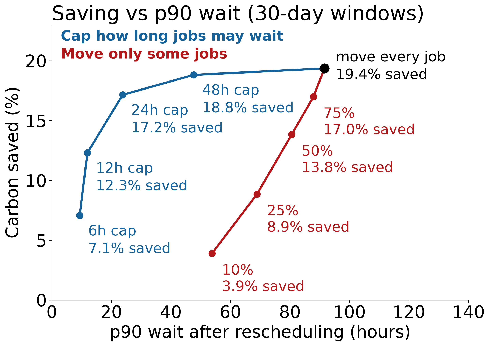

# HPC EASE

## Table of contents

**HPC EASE** (**H**igh **P**erformance **C**omputing **E**missions-**A**ware **S**cheduling **E**valuator) estimates the carbon footprint of Slurm jobs from a historical database, and simulates how much carbon could be saved by moving those jobs into low-carbon-intensity windows. It was written for JASMIN's LOTUS cluster as part of a six-month project by James Ravindran with supervision from Jessica Huntley and David McDonagh. As the cluster metadata, power model and carbon source are read from a config file, it can be pointed at another cluster's history, so it's not strictly tied to LOTUS.

- [Installation](#installation)
- [Usage](#usage)
  1. [Describe your dataset: `dataset.toml`](docs/Usage.md#1-describe-your-dataset-via-datasettoml)
  2. [Export jobs to Parquet: `toparquet.py`](docs/Usage.md#2-export-jobs-to-parquet-toparquetpy)
  3. [Simulate one window: `process.py`](docs/Usage.md#3-simulate-one-window-processpy)
  4. [Sweep many windows: `runmultiple.py` → `benchmark/process.py` → `compare.py`](docs/Usage.md#4-sweep-many-windows)
- [How it works](docs/How%20it%20works.md)
- [Worked example: the logs behind the example graph](#worked-example-the-logs-behind-this-graph)

## Installation

Dependencies are managed with [uv](https://docs.astral.sh/uv/) (this project was tested with Python 3.13, but it may work with other versions):

```bash
uv sync
```

Run the scripts from the directory they live in (`main/`, `benchmark/` or `reportgen/`), not the repo root. Single simulations need nothing beyond `uv sync`. Sweeps with `runmultiple.py` also need Slurm or [Task Spooler](https://viric.name/soft/ts/). Each run is wrapped in GNU `time`, so `/usr/bin/time` must exist on every node that runs jobs (the compute nodes on Slurm, or your own machine with Task Spooler).

## Usage

The workflow has four steps. Each one is covered in detail in [docs/Usage.md](docs/Usage.md).

1. **Describe your dataset.** Copy `dataset.example.toml` to `dataset.toml` and fill in your cluster size, power figures and carbon-intensity CSV.
2. **Export jobs to Parquet.** `toparquet.py` dumps completed jobs from the Slurm accounting database.
3. **Simulate one window.** `process.py` reschedules one window of jobs and reports the carbon saving.
4. **Sweep many windows.** `runmultiple.py` runs `process.py` across many dates, then `benchmark/process.py` and `compare.py` turn the logs into CSVs and comparisons.

A minimal run, from the `main/` directory:

```bash
cd main
uv run toparquet.py
uv run process.py --chosen-day 2025-02-15 --days-to-fetch 7 \
    --jobs-file ../dbexports/all_jobs_full.parquet
```

`toparquet.py` needs read access to your Slurm accounting database (settings in `.env`). If you have no database access, you can build the Parquet file another way; [docs/Usage.md](docs/Usage.md#2-export-jobs-to-parquet-toparquetpy) describes the expected format.

For an overview of what the simulator and the benchmark harness do and how the files fit together, see [How it works](docs/How%20it%20works.md).

## Worked example: the logs behind this graph



The graph above compares pooled carbon saving against 90th-percentile wait for LOTUS, one point per setting, for 30-day windows. The plotting code is not in this repository, so this section only covers how to produce the logs it reads. The recipe is one baseline plus 8 variants, each a separate `runmultiple.py` invocation over every 30-day window from `from_date`, all on the same commit and the same dates.

Settings, as `process.py` flags:

| Arm | Flags added to the baseline |
|---|---|
| Baseline | None |
| Wait cap | `--max-wait 6`, `--max-wait 12`, `--max-wait 24`, `--max-wait 48` |
| Move some jobs | `--reschedule-percent 10`, `25`, `50`, `75` |

The runs used the defaults for everything else (head weight 4, head fraction 0.25, defer on with a 72h timeout, 10 days warm-up, 3 days cool-down) and `--count-violations`, which gives the violating-energy figures and does not change any placement. The seed is the default 0.

```bash
cd benchmark
COMMON="--use-slurm --route myroute --days-to-fetch 30 --count-violations \
        --jobs-file /path/on/the/cluster/all_jobs_full.parquet --commit <sha>"

uv run runmultiple.py $COMMON                                   # baseline
for h in 6 12 24 48; do
  uv run runmultiple.py $COMMON --max-wait $h
done
for p in 10 25 50 75; do
  uv run runmultiple.py $COMMON --reschedule-percent $p
done
```

That is 9 invocations. Each writes its own log in `benchmark/temp/`, and the name carries the suffix that tells the arms apart (`-mw24`, `-rp50` and so on; the baseline has neither). Keep `--commit` the same so every arm runs the same code. Then:

```bash
uv run process.py          # one CSV per log in benchmark/processed/
uv run compare.py processed/<baseline>.csv processed/<arm>.csv --from-date 2025-02-01
```

The graph's inputs are the CSVs' per-window `carbon`, `carbon_2` and wait columns (`wait_p90_2`). A log row keeps only each run's median, p90, p95, p99 and maximum wait, so a pooled percentile across windows can only be bracketed from the per-window values, not computed exactly.

Practical points when you launch this many sweeps at once:

- Each invocation resolves dependencies in its own snapshot. `uv.lock` is git-ignored, so many at once can hit uv's cache lock timeout; stagger the launches and consider `export UV_LOCK_TIMEOUT=1800`.
- `--days-to-fetch 30` streams 43 days per run (30 + 10 + 3), so the route needs a `resources` row that covers 43 days. The limits in the example file are placeholders.
- Size the total before launching: on LOTUS these 9 arms were about 4,000 individually submitted jobs of 30 days each (453 dates per arm).